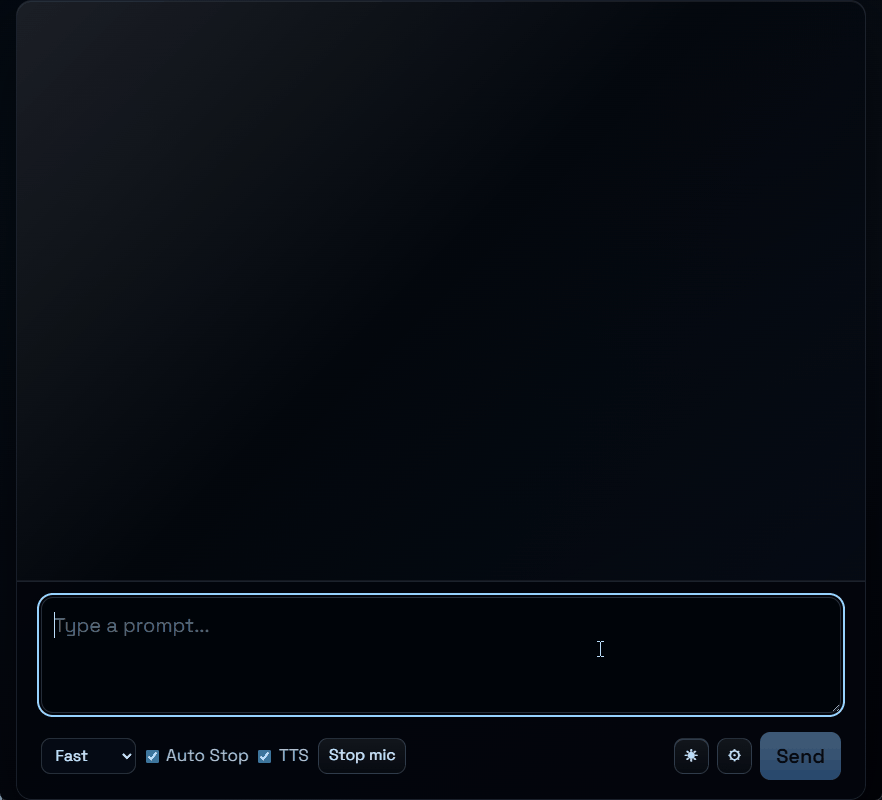

# 🎙️ Vox Golem

[](https://github.com/git-blame-dev/vox-golem/actions/workflows/ci.yml)
[](https://github.com/git-blame-dev/vox-golem/releases/latest)

A voice and chat assistant for desktop, Android and Wear OS, with configurable response backends, local desktop transcription, and shared phone/watch conversations.



*Earlier desktop interface; the current app uses Material 3 navigation.*

## 🔎 Overview

Vox Golem combines hands-free desktop voice capture and typed chat with phone and watch assistants. Desktop and phone share one React interface; Wear uses a native Kotlin/Compose shell. Shared Rust code owns portable conversation and speech policy, with platform adapters for storage, audio and device lifecycle.

Desktop offers local `llama.cpp`, Custom and OpenCode backends. Phone and Wear use Custom-provider chat and can each execute requests once access and connectivity are available. Phone/watch conversation sharing uses native pairing; it does not replicate desktop history.

## ✨ Features

- Desktop wake-word capture, voice activity detection and local transcription, with typed prompts in the same conversation view.
- Configurable local and remote response backends, optional desktop completion, and model-led web tools controlled by a Web permission.
- Desktop spoken replies through an external Neural TTS service, with native playback and cancellation. Phone and watch use native speech SDKs.
- Shared phone/watch conversation history, with local drafts and explicit conversation branches.
- Phone **Vox Chat**, **Vox Ask** and **Vox Talk** launchers, plus a separate watch voice-note capture and phone export workflow.
- Signed desktop updater packages, with automatic installation gated on the app being idle.

Feature availability depends on platform, configured assets, permissions and provider support. The [platform matrix](docs/technical-guide.md#platform-boundaries) describes those boundaries.

## 🛠️ Tech Stack

- **Desktop and phone shells:** Tauri 2 with Rust; Android native plugins use Kotlin.
- **Shared interface:** React 19, TypeScript, Vite, Bun, Vitest and ESLint.
- **Wear interface:** Kotlin/Compose with Rust through JNI.
- **Portable runtime:** Rust workspace for conversation policy, provider tools, speech delivery and platform contracts.
- **Desktop voice:** native capture, wake-word detection, Silero VAD, local transcription and an external Neural TTS service.
- **Mobile storage and transport:** app-private SQLite and native Wear Data Layer exchanges.
- **CI / packaging:** Linux-hosted GitHub Actions, Linux AppImage packaging, Windows NSIS cross-builds, and Android/Wear builds.

## 🧠 Engineering Highlights

- Shared domain rules keep desktop, phone and Wear behavior aligned while adapters own platform effects and resource cleanup.
- Bounded audio, tool and diagnostic work protects responsiveness; cancellation and ownership checks prevent stale operations from taking over newer work.
- Phone/watch synchronization exchanges immutable conversation records with receiver commit and explicit acknowledgements. Concurrent continuations retain separate heads.
- Optional desktop diagnostics use categorical records, bounded storage and a maximum 90-day retention policy; they exclude raw prompts, answers, audio and credentials.
- Model assets, configuration, credentials, recordings and generated reports remain outside source control. Listening cues have a [reproducible synthetic source](scripts/listening-cues.md).

## 🏗️ Architecture

```text
Desktop / Android phone                 Wear OS
React + Tauri                           Kotlin / Compose
       |                                      |
       +---------- native adapters -----------+
                          |
                 Shared Rust domain
          conversation / speech / provider tools
                          |
       local runtimes / remote providers / platform SDKs
```

The shared frontend owns interaction and pending projections. Rust owns canonical portable transitions; native shells own permissions, audio, storage and lifecycle. Phone/watch replication is separate from provider credentials and from voice-note capture.

Key directories:

- [`frontend/app/`](frontend/app/) — shared React interface and browser preview.
- [`apps/desktop-tauri/`](apps/desktop-tauri/) — Linux/Windows shell and packaging.
- [`apps/android-tauri/`](apps/android-tauri/README.md) — phone shell and build guide.
- [`apps/wear/`](apps/wear/README.md) — native Wear shell and build guide.
- [`crates/core/`](crates/core/) and [`crates/platform/`](crates/platform/) — portable domain and platform contracts.
- [`crates/assistant-android/`](crates/assistant-android/README.md) and [`crates/capture-android/`](crates/capture-android/README.md) — shared native mobile adapters.
- [`Makefile`](Makefile) — local verification, build and packaging commands.

## 🚀 Getting Started

### Supported Linux baseline

The desktop release baseline is Ubuntu 24.04 LTS x86_64, including WSL2/WSLg. Windows 11 x64 is a separate runtime target; Linux checks do not establish Windows readiness.

For Linux development, use Bun 1.3.9, Rust 1.95.0 and Tauri CLI 2.11.1 with the native packages in the [setup guide](docs/technical-guide.md#wsl2wslg-setup). Android/Wear also need JDK 21, SDK platform 36 (plus platform 37.0 for Wear), build tools 36 and NDK 28.2.13676358; see the [mobile build prerequisites](docs/technical-guide.md#android-and-wear-builds).

### Configure local assets

On Linux, copy [`config.example.toml`](config.example.toml) to `${XDG_CONFIG_HOME:-$HOME/.config}/voxgolem/config.toml`. Windows uses `%APPDATA%\VoxGolem\config.toml`. Relative asset paths resolve beside that file.

Configure only the capabilities you intend to use. Local model profiles also require external model/runtime files and a non-empty `SOUL.md` beside the config. Desktop speech uses an independently installed Neural service; Piper configurations require migration. Missing optional assets disable the affected capability.

### ChatGPT device-code sign-in

For Custom-provider access, use **Settings → Model → Continue with ChatGPT** on desktop or phone. Wear receives short-lived access through its paired phone. See the [sign-in and credential boundaries](docs/technical-guide.md#chatgpt-device-code-sign-in). OpenCode uses its own CLI login separately.

### Install and verify

From the repository root:

```bash
bun install --frozen-lockfile
make test
make app          # native Linux app
make app-dev      # browser UI development with a simulated runtime
```

For mobile builds, use `make android-release` or `make wear-performance` after the documented toolchain setup. The phone release is unsigned without local signing configuration; Wear performance builds use a development signature. These commands do not install applications.

## ✅ Testing

```bash
make test                 # deterministic frontend and Rust checks
make test-benchmark       # shared controller tests; no device access
make test-app-benchmark   # offline desktop benchmark tooling tests
make android-assistant-test
make android-capture-test
make wear-test
```

Mobile native checks need the [documented Tauri/Gradle bootstrap](crates/voice-android/README.md). The [benchmark guide](tools/benchmark/README.md) distinguishes offline tests, live provider work and target-runtime measurements.

Automated tests and builds cover software behavior and compatibility. Microphone, audible output, GPU, Windows runtime and physical phone/watch acceptance require matching target-runtime checks.

## 📦 Releases / Artifacts

No releases are currently published. Future approved downloads will appear on [GitHub Releases](https://github.com/git-blame-dev/vox-golem/releases).

The manually dispatched desktop release workflow builds Linux ZIP/AppImage and Windows NSIS packages with updater signatures and checksums. Updater signatures are separate from Windows Authenticode signing; Windows packages may trigger SmartScreen. Models, system GPU libraries, credentials and user data stay external.

```bash
make dist          # stage Linux files in dist/VoxGolem/
make update-bundle # build a local AppImage; unsigned without signing configuration
make pc-installer  # cross-build the Windows NSIS installer on Linux
```

See the [updater guide](docs/technical-guide.md#signed-application-updates) for signing, idle installation and failure behavior.

## ⚠️ Limitations

- This is not an entirely offline system: Custom/OpenCode backends and web tools use configured services. Wear Data Layer can route through Google servers.
- On-device mobile recognition depends on installed language/provider support. Allowing fallback can permit network speech processing.
- Desktop history does not synchronize with phone/Wear. Credentials use a separate channel from conversation replication.
- Local voice/model capabilities require external assets. Neural speech latency depends on the configured service and model.
- Saved wake clips and voice-note recordings are local user data with separate storage policies; diagnostic retention does not prune recordings.
- Build success and earlier demos do not establish current physical-device, Windows, acoustic or production-performance acceptance.

## 🧯 Troubleshooting

- **Missing capability:** check the configuration and external assets for that platform; start with the [setup guide](docs/technical-guide.md#wsl2wslg-setup).
- **Provider unavailable:** check sign-in and the selected backend. Authentication success does not guarantee model access.
- **Desktop speech unavailable:** check the [Neural service configuration](docs/technical-guide.md#desktop-speech) and installed voices.
- **Android native check fails before tests:** complete the [phone scaffold/build bootstrap](crates/voice-android/README.md).
- **Need detailed operational behavior:** use the [technical guide](docs/technical-guide.md), [phone guide](apps/android-tauri/README.md) and [Wear guide](apps/wear/README.md).
